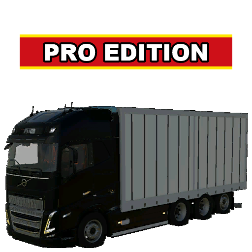

# ModHub upload: Box Truck Pro Edition

What to enter in the GIANTS ModHub upload form for this mod. Each text box below has a copy button on GitHub.



**Mod Icon (512x512):** [`icon_512.png`](icon_512.png)

| Field | Value |
|-------|-------|
| Title English | Box Truck Pro Edition |
| Title German | Kofferaufbau-LKW Pro Edition |
| Title French | Camion caisse Pro Edition |
| Version | `1` `5` `4` `1` |
| Author | DTM Mods, PropaineX |
| Manufacturer | Volvo |
| Category 1 | Drivables > Trucks |
| Category 2 | Not Set |
| Category 3 | Not Set |

## Title English
```text
Box Truck Pro Edition
```

## Title German
```text
Kofferaufbau-LKW Pro Edition
```

## Title French
```text
Camion caisse Pro Edition
```

## Description English
```text
Box Truck Pro Edition adds two pallet trucks built on the game's Volvo FH16 8x4 cab and chassis: the Box Truck, a curtain-sider in the style of the Krone ProfiLiner, and the Flatbed Truck with an open deck.

- Box Truck: the curtain gathers at the rear, the side boards fold away and the posts slide back for loading from the side; rear barn doors
- Box Truck: load space about 6.8 x 2.48 m, 2.55 m inside height; curtain designs plain white, ProEdition, Krone, Farming Simulator League and GIANTS
- Flatbed Truck: 6.85 x 2.55 m wooden deck, side walls or sliding stakes, 2.44 m between the stakes, 10 off-road tyre options
- 9 tension belts on both trucks
- Four engines from 425 to 600 hp (FH425 City Hauler to FH600 Heavy Hauler), 90 km/h
- Works with Universal Autoload when it is installed
- Price: Box Truck 175,000, Flatbed Truck 155,000

Controls (can be changed in the controls menu): X rear doors or side walls, Z open/close the selected curtain, U select the left or right curtain.

Changelog 1.5.4.0:
- With Universal Autoload, both trucks pick up pallets from the same zone beside the truck as the Krone ProfiLiner.
- Flatbed: the frame bar under the side walls no longer flickers.
```

## Description German
```text
Box Truck Pro Edition bringt zwei Paletten-LKW auf Basis von Fahrerhaus und Fahrgestell des Volvo FH16 8x4 aus dem Spiel: den Kofferaufbau-LKW mit Planenaufbau im Stil des Krone ProfiLiner und den Pritschen-LKW mit offener Ladefläche.

- Kofferaufbau-LKW: die Plane rafft sich hinten zusammen, die Seitenbretter klappen weg und die Rungen fahren nach hinten, zum Beladen von der Seite; Hecktüren
- Kofferaufbau-LKW: Ladefläche ca. 6,8 x 2,48 m, 2,55 m Innenhöhe; Planendesigns Weiß, ProEdition, Krone, Farming Simulator League und GIANTS
- Pritschen-LKW: 6,85 x 2,55 m Holzboden, Bordwände oder verschiebbare Rungen, 2,44 m zwischen den Rungen, 10 Geländereifen-Optionen
- 9 Spanngurte auf beiden LKW
- Vier Motoren von 425 bis 600 PS (FH425 City Hauler bis FH600 Heavy Hauler), 90 km/h
- Funktioniert mit Universal Autoload, wenn es installiert ist
- Preis: Kofferaufbau-LKW 175.000, Pritschen-LKW 155.000

Steuerung (im Steuerungsmenü änderbar): X Hecktüren bzw. Bordwände, Z gewählte Plane öffnen/schließen, U linke oder rechte Plane wählen.

Changelog 1.5.4.0:
- Mit Universal Autoload nehmen beide LKW Paletten aus derselben Zone neben dem LKW auf wie der Krone ProfiLiner.
- Pritsche: die Rahmenleiste unter den Bordwänden flackert nicht mehr.
```

## Description French
```text
Box Truck Pro Edition ajoute deux camions à palettes basés sur la cabine et le châssis du Volvo FH16 8x4 du jeu : le camion caisse, une savoyarde dans le style du Krone ProfiLiner, et le camion plateau à pont ouvert.

- Camion caisse : la bâche se replie à l'arrière, les planches latérales s'escamotent et les montants coulissent vers l'arrière pour charger par le côté ; portes arrière battantes
- Camion caisse : espace de chargement d'environ 6,8 x 2,48 m, 2,55 m de hauteur intérieure ; bâches blanc uni, ProEdition, Krone, Farming Simulator League et GIANTS
- Camion plateau : plancher en bois de 6,85 x 2,55 m, ridelles ou ranchers coulissants, 2,44 m entre les ranchers, 10 options de pneus tout-terrain
- 9 sangles sur les deux camions
- Quatre moteurs de 425 à 600 ch (FH425 City Hauler à FH600 Heavy Hauler), 90 km/h
- Compatible avec Universal Autoload s'il est installé
- Prix : camion caisse 175 000, camion plateau 155 000

Commandes (modifiables dans le menu des commandes) : X portes arrière ou ridelles, Z ouvrir/fermer la bâche choisie, U choisir la bâche gauche ou droite.

Changelog 1.5.4.0 :
- Avec Universal Autoload, les deux camions prennent les palettes dans la même zone à côté du camion que le Krone ProfiLiner.
- Plateau : la barre du cadre sous les ridelles ne scintille plus.
```

## Before uploading

- Trademarks: two curtain designs carry the Farming Simulator League and GIANTS logos. These are GIANTS' own marks, not licensed brands a mod may use; ask GIANTS or remove those two designs before uploading. (Volvo and Krone are licensed in the base game.)
- The mod's own in-game description (modDesc) is out of date: it only describes the Box Truck, not the Flatbed Truck. There are no French texts in the mod (German is there).
