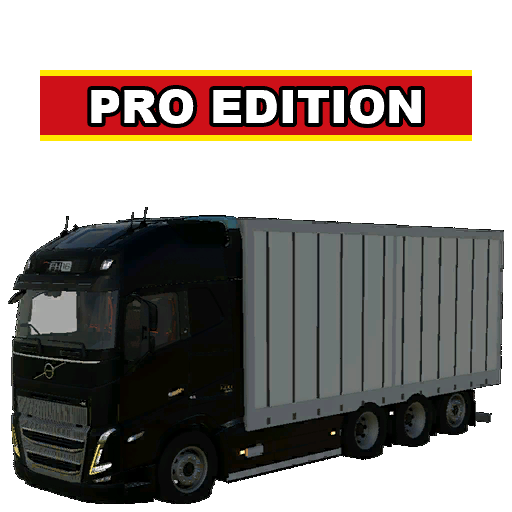

# ModHub upload: Box Truck Pro Edition

What to enter in the GIANTS ModHub upload form for this mod. Each text box below has a copy button on GitHub.



**Mod Icon (512x512):** [`icon_512.png`](icon_512.png)

| Field | Value |
|-------|-------|
| Title English | Box Truck Pro Edition |
| Title German | Kofferaufbau-LKW Pro Edition |
| Title French | Camion caisse Pro Edition |
| Version | `1` `5` `4` `1` |
| Author | DTM Mods, PropaineX |
| Manufacturer | Volvo |
| Category 1 | Drivables > Trucks |
| Category 2 | Not Set |
| Category 3 | Not Set |

## Title English
```text
Box Truck Pro Edition
```

## Title German
```text
Kofferaufbau-LKW Pro Edition
```

## Title French
```text
Camion caisse Pro Edition
```

## Description English
```text
FH16 Box Truck
Category: Pro Edition Trucks
Price: $175,000
Power: 425 - 600 hp
Max. speed: 90 kph

Flatbed Truck Pro Edition
Category: Pro Edition Trucks
Price: $155,000
Power: 425 - 600 hp
Max. speed: 90 kph

Volvo FH16 8x4 with a curtain-sider body for hauling pallets.

- Curtain-sider in the style of the Krone ProfiLiner: the curtain gathers at the rear, the side boards fold away
  and the posts slide back
- Rear barn doors
- 9 tension belts across the load floor
- Load space about 6.8 x 2.48 m, 2.55 m inside height
- Four engines: FH425 City Hauler, FH515 Regional Hauler, FH585 Long Hauler, FH600 Heavy Hauler
- Plain white paint option that matches the body
- Curtain designs: plain white, ProEdition, Krone, Farming Simulator League, GIANTS

Flatbed Truck: the same FH16 8x4 with a 6.85 x 2.55 m wooden deck, side walls or sliding stakes and 9 tension belts.

Controls (can be changed in the controls menu):
X = open/close rear doors (Flatbed: lower/raise the side walls or gather/spread the stakes)
Z = open/close the selected curtain
U = select left or right curtain
```

## Description German
```text
FH16 Box Truck
Shopkategorie: Pro Edition Trucks
Preis: 175.000 €
Leistung: 425 - 600 PS
Höchstgeschwindigkeit: 90 km/h

Flatbed Truck Pro Edition
Shopkategorie: Pro Edition Trucks
Preis: 155.000 €
Leistung: 425 - 600 PS
Höchstgeschwindigkeit: 90 km/h

Volvo FH16 8x4 mit Planenaufbau für den Palettentransport.

- Planenaufbau wie beim Krone ProfiLiner: die Plane rafft sich hinten zusammen, die Seitenbretter klappen weg
  und die Rungen fahren nach hinten
- Hecktüren
- 9 Spanngurte über die Ladefläche
- Ladefläche ca. 6,8 x 2,48 m, 2,55 m Innenhöhe
- Vier Motoren: FH425 City Hauler, FH515 Regional Hauler, FH585 Long Hauler, FH600 Heavy Hauler
- Weiße Lackierung ohne Metallic, passend zum Aufbau
- Planendesigns: Weiß, ProEdition, Krone, Farming Simulator League, GIANTS

Pritschen-LKW (Flatbed Truck): derselbe FH16 8x4 mit 6,85 x 2,55 m Holzboden, Bordwänden oder verschiebbaren Rungen und 9 Spanngurten.

Steuerung (im Steuerungsmenü änderbar):
X = Hecktüren öffnen/schließen (Pritsche: Bordwände abklappen/hochklappen bzw. Rungen zusammenschieben/auseinanderziehen)
Z = gewählte Plane öffnen/schließen
U = linke oder rechte Plane wählen
```

## Description French
```text
FH16 Box Truck
Catégorie : Pro Edition Trucks
Prix : 175 000 $
Puissance : 425 - 600 ch
Vitesse max. : 90 km/h

Flatbed Truck Pro Edition
Catégorie : Pro Edition Trucks
Prix : 155 000 $
Puissance : 425 - 600 ch
Vitesse max. : 90 km/h

Volvo FH16 8x4 avec une carrosserie savoyarde pour le transport de palettes.

- Savoyarde dans le style du Krone ProfiLiner : la bâche se replie à l'arrière, les planches latérales s'escamotent
  et les montants coulissent vers l'arrière
- Portes arrière battantes
- 9 sangles sur le plancher de chargement
- Espace de chargement d'environ 6,8 x 2,48 m, 2,55 m de hauteur intérieure
- Quatre moteurs : FH425 City Hauler, FH515 Regional Hauler, FH585 Long Hauler, FH600 Heavy Hauler
- Option de peinture blanc uni assortie à la carrosserie
- Bâches : blanc uni, ProEdition, Krone, Farming Simulator League, GIANTS

Camion plateau (Flatbed Truck) : le même FH16 8x4 avec un plancher en bois de 6,85 x 2,55 m, des ridelles ou des ranchers coulissants et 9 sangles.

Commandes (modifiables dans le menu des commandes) :
X = ouvrir/fermer les portes arrière (plateau : abaisser/relever les ridelles ou rapprocher/écarter les ranchers)
Z = ouvrir/fermer la bâche choisie
U = choisir la bâche gauche ou droite
```

## Screenshots

Upload the 6 images in [`screenshots/`](screenshots/) (1600x900, unedited in-game shots) in this order: [`1.jpg`](screenshots/1.jpg), [`2.jpg`](screenshots/2.jpg), [`3.jpg`](screenshots/3.jpg), [`4.jpg`](screenshots/4.jpg), [`5.jpg`](screenshots/5.jpg), [`6.jpg`](screenshots/6.jpg).

## Before uploading

- Trademarks: two curtain designs carry the Farming Simulator League and GIANTS logos. These are GIANTS' own marks, not licensed brands a mod may use; ask GIANTS or remove those two designs before uploading. (Volvo and Krone are licensed in the base game.)
- The mod's own in-game description (modDesc) is out of date: it only describes the Box Truck, not the Flatbed Truck. There are no French texts in the mod (German is there).
